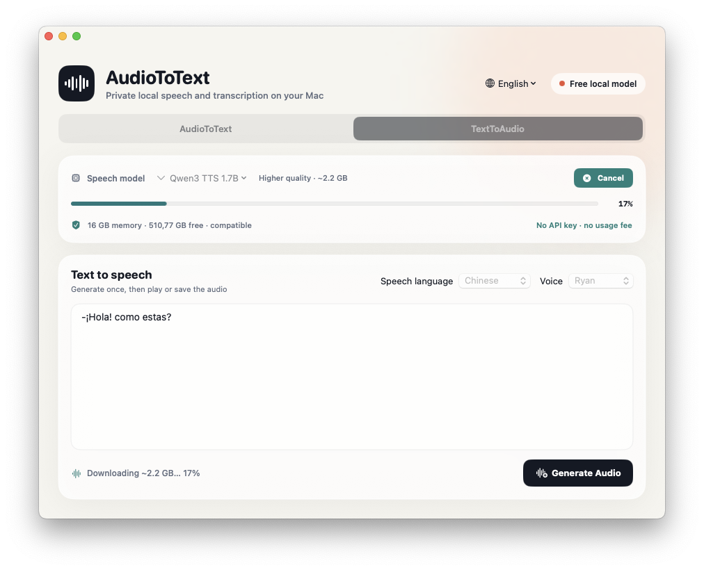
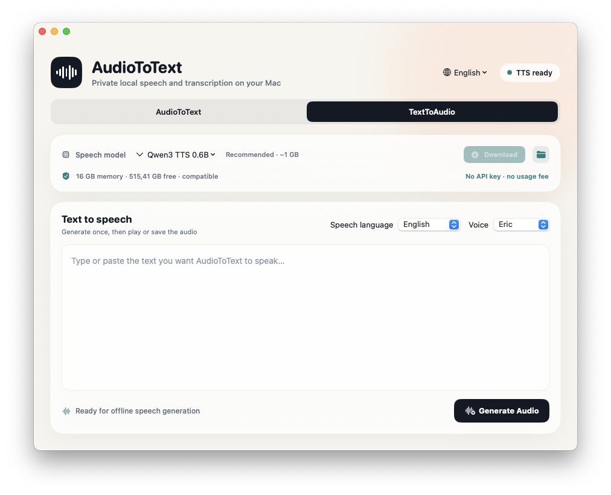
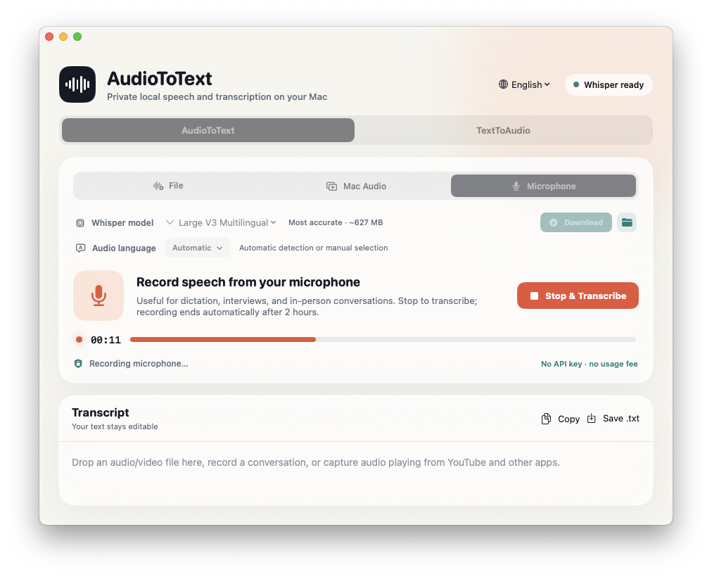
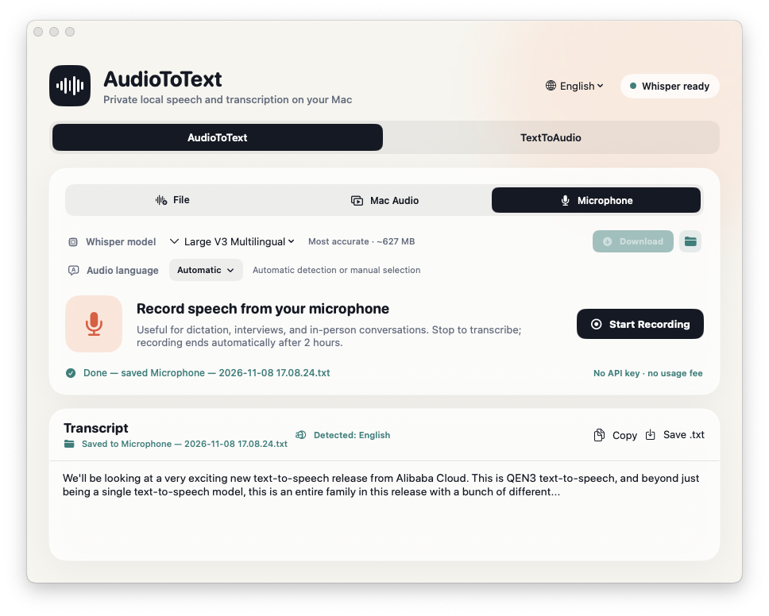

# AudioToText

AudioToText is a free, open-source macOS app for two private, local workflows:

- **AudioToText** transcribes audio, video, microphone, and Mac system audio with Whisper.
- **TextToAudio** turns text into natural speech with Qwen3-TTS, then plays it or saves it as M4A or MP3.

No API key, account, subscription, or usage fee is required. Models are downloaded only after you press **Download** and work offline after preparation.

## Download

[**Download AudioToText 0.3.3 for macOS (.dmg)**](https://github.com/Antonkog/AudioToText/raw/refs/heads/main/Releases/AudioToText-0.3.3.dmg) · [SHA-256 checksum](Releases/AudioToText-0.3.3.dmg.sha256)

AudioToText uses a stable community signature, but it is not signed with a paid Apple Developer ID or notarized by Apple. macOS may therefore report that the developer cannot be verified, or that the app is damaged and cannot be opened.

First, download both files into the same folder and verify that the DMG matches the checksum published in this repository:

```sh
cd ~/Downloads
shasum -a 256 -c AudioToText-0.3.3.dmg.sha256
```

Continue only if Terminal prints `AudioToText-0.3.3.dmg: OK`. Open the DMG and drag **AudioToText** into **Applications**, then use one of the following methods.

### Remove quarantine in Terminal

Use this only for the verified AudioToText download from this repository. The command recursively clears the downloaded-file attributes from this exact app bundle:

```sh
xattr -cr /Applications/AudioToText.app
open /Applications/AudioToText.app
```

### Use Open Anyway

1. Try to open AudioToText and click **Cancel** or **Done** on the warning.
2. Open **System Settings → Privacy & Security** and scroll to **Security**.
3. Click **Open Anyway**, authenticate if requested, then click **Open**.

[Apple documents this override](https://support.apple.com/guide/mac-help/mh40617/mac) and notes that the button is available for about one hour after the failed launch. Never use either bypass for a DMG whose checksum does not match.

### Build your own DMG

No paid Apple developer key is needed to build AudioToText locally. Install Xcode 16 or newer, or its command-line tools, then clone the source rather than downloading a prebuilt app:

```sh
xcode-select --install
git clone https://github.com/Antonkog/AudioToText.git
cd AudioToText
./Scripts/build-dmg.sh
open dist
```

The locally created `dist/AudioToText-0.3.3.dmg` and checksum use ad-hoc signing when no signing identity is installed. Because the app was built locally rather than downloaded as an executable, it normally has no internet quarantine flag. If you redistribute that DMG, other Macs will still show the unsigned/unnotarized warning.

## Screenshots

### Text to audio

Downloading and preparing the 1.7B text-to-speech model with visible progress and cancellation.



TextToAudio ready for offline speech generation with model, language, and voice controls.



### Recording and transcription

Recording speech from the microphone with an elapsed-time indicator and the option to stop and transcribe.



Completed transcription with automatic language detection and the locally saved text file.



## TextToAudio

- Switch between **AudioToText** and **TextToAudio** at the top of the app. The last mode is remembered.
- Choose one of two local Qwen3-TTS Core ML models:

  | Model | Approximate download | Memory guidance |
  | --- | ---: | --- |
  | Qwen3-TTS 0.6B | 1 GB | Recommended for 8 GB and 16 GB Macs |
  | Qwen3-TTS 1.7B | 2.2 GB | Recommended for 16 GB or more |

- The app checks Apple-silicon architecture, macOS version, physical memory, and free storage before a download. It blocks unsupported systems or insufficient storage and warns before using the 1.7B model below 16 GB.
- Downloads start only after **Download** and a size confirmation. Progress, cancellation, cache validation, tokenizer preparation, and sequential Core ML prewarming are included.
- Generate English, Chinese, Japanese, Korean, German, French, Russian, Portuguese, Spanish, or Italian speech.
- Choose Ryan, Aiden, Ono Anna, Sohee, Eric, Dylan, Serena, Vivian, or Uncle Fu.
- Generate once, then reuse the same result for playback and both export formats. Editing the text or changing the model, language, or voice invalidates the previous result.
- Play, pause, or stop inside the app. Save through native macOS panels as M4A or 128-kbps mono MP3.
- Click a **Saved to…** status to reveal the exact exported file in Finder.

Voice cloning and style-instruction controls are not included in version 0.3.3.

## AudioToText

- Import common audio formats and videos containing an audio track.
- Open an audio or video file with AudioToText directly from Finder.
- Capture Mac audio from YouTube, movies, meetings, and other apps.
- Record speech, interviews, or dictation from a microphone.
- Automatically stop any recording after two hours.
- Choose from English-only or multilingual Whisper models:

  | Model | Languages | Approximate download |
  | --- | --- | ---: |
  | Tiny English | English | 153 MB |
  | Base English | English | 147 MB |
  | Small English | English | 487 MB |
  | Tiny Multilingual | Multilingual | 76.6 MB |
  | Base Multilingual | Multilingual | 147 MB |
  | Small Multilingual | Multilingual | 486 MB |
  | Medium Multilingual | Multilingual | 1.53 GB |
  | Large V3 Multilingual | Multilingual | 627 MB |
- Automatically detect the spoken language with any multilingual model, or choose manually from every language supported by WhisperKit.
- Keep the transcript in the language being spoken; AudioToText does not translate it into another language.
- See real progress and cancel file, microphone, and Mac-audio transcription.
- Edit, copy, and save transcripts as UTF-8 `.txt` files.
- Automatically save completed transcripts in `~/Documents/AudioToText`.
- Click **Done — saved…** or **Saved to…** to reveal the exact transcript file in Finder.

## Interface languages

Use the globe menu to switch the interface instantly between System Default, English, Spanish, Simplified Chinese, Hindi, Arabic, Brazilian Portuguese, French, German, Japanese, and Russian. Arabic uses a right-to-left layout. All new TextToAudio controls, status messages, alerts, compatibility guidance, and save panels are localized.

## Privacy and offline use

AudioToText does not upload audio, text, or generated speech to an app-owned server. Processing happens locally. Temporary recordings and MP3 conversion files are removed after use.

Whisper models are downloaded from the public [AudioToText WhisperKit mirror](https://huggingface.co/RedHotAnton/whisperkit-coreml), backed by the upstream [WhisperKit Core ML repository](https://huggingface.co/argmaxinc/whisperkit-coreml). TTS models and tokenizer files are downloaded from the public [AudioToText TTSKit](https://huggingface.co/RedHotAnton/ttskit-coreml) and [Qwen tokenizer](https://huggingface.co/RedHotAnton/Qwen3-0.6B) mirrors. After an explicitly selected model has downloaded and been prepared, generation does not initiate a network download.

Downloaded models are stored under:

```text
~/Documents/huggingface/models/RedHotAnton/whisperkit-coreml/
~/Documents/huggingface/models/RedHotAnton/ttskit-coreml/
~/Documents/huggingface/models/RedHotAnton/Qwen3-0.6B/
```

Existing downloads in the previous `argmaxinc` and `Qwen` cache folders remain recognized and do not need to be downloaded again.

Switching modes unloads the inactive model family to reduce memory use.

## Requirements

- macOS 15 or newer
- Apple-silicon Mac
- 8 GB memory for Qwen3-TTS 0.6B; 16 GB or more is recommended for 1.7B
- At least the model download size plus 1 GB of available storage
- Xcode 16 or a compatible Swift 6 toolchain when building from source

The 8 GB compatibility path is covered by unit tests but still needs final validation on physical 8 GB Apple-silicon hardware.

## Build and run

```sh
git clone https://github.com/Antonkog/AudioToText.git
cd AudioToText
chmod +x Scripts/build-app.sh Scripts/build-dmg.sh Scripts/build-lame.sh Scripts/generate-icon.swift
./Scripts/build-app.sh
open dist/AudioToText.app
```

The first build downloads Swift package dependencies and builds the pinned standalone LAME encoder from its official source after SHA-256 verification. In the app, choose a model and press **Download**. Changing a selected model never begins a download by itself.

For development without creating an app bundle:

```sh
swift run AudioToText
```

Run the tests with:

```sh
swift test
```

Create a distributable DMG with:

```sh
./Scripts/build-dmg.sh
```

The DMG and its SHA-256 checksum are written to `dist/`. Models are not included in the DMG.

## macOS permissions

- **Microphone** permission is requested only when microphone recording is used.
- **Screen & System Audio Recording** permission is required to capture Mac audio. AudioToText uses the native macOS permission prompt and does not place an app alert over it.

If Mac Audio reports that access was declined, open **System Settings → Privacy & Security → Screen & System Audio Recording**, enable AudioToText, then quit and reopen the app.

Release 0.3.2 and later use a stable community signing identity so macOS can recognize updates as the same app for Screen Recording permission. The certificate is self-signed, not Apple-notarized, so the first-launch Control-click step above is still required. Users upgrading from 0.3.1 or earlier must grant Screen Recording once more after installing 0.3.2.

Local ad-hoc builds receive a new code identity when the executable changes, so macOS may ask for permission again after rebuilding. To preserve identity across local builds, sign with an installed Apple code-signing identity:

```sh
CODE_SIGN_IDENTITY="Apple Development: Your Name (TEAMID)" ./Scripts/build-app.sh
```

## Technology and licensing

- SwiftUI for the native macOS interface and custom waveform brand artwork.
- [WhisperKit and TTSKit](https://github.com/argmaxinc/argmax-oss-swift) for local Core ML inference.
- ScreenCaptureKit for Mac system-audio capture.
- AVFoundation for recording, media extraction, M4A output, and playback.
- [LAME 4.0](https://lame.sourceforge.io/) runs as a separately signed standalone executable for MP3 export. It is not linked into the Swift target. The app bundle includes the LGPL license and [third-party notices](THIRD_PARTY_NOTICES.md).

AudioToText is available under the [MIT License](LICENSE). WhisperKit, TTSKit, LAME, and downloaded model assets retain their respective licenses and notices.
