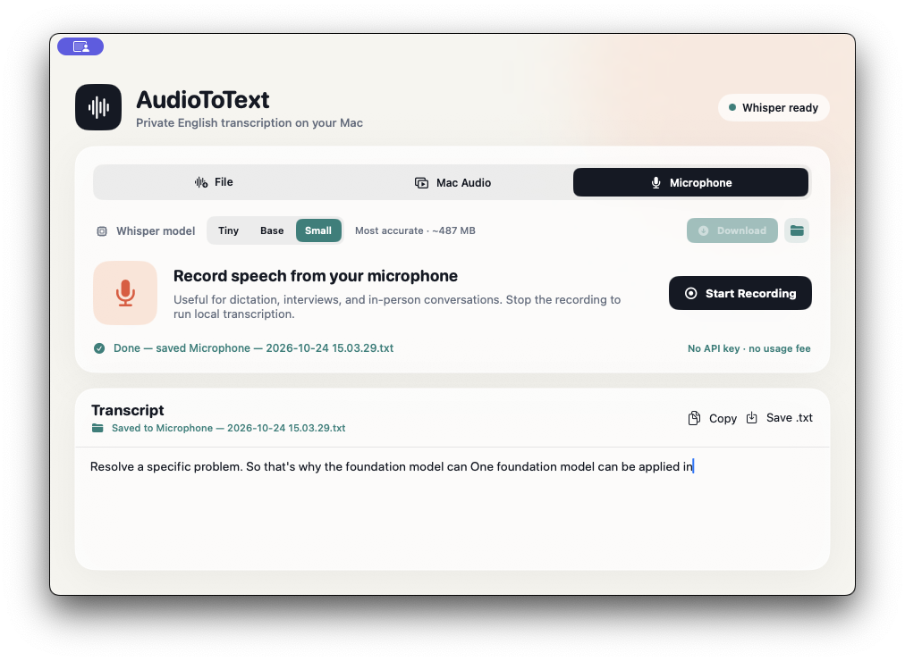
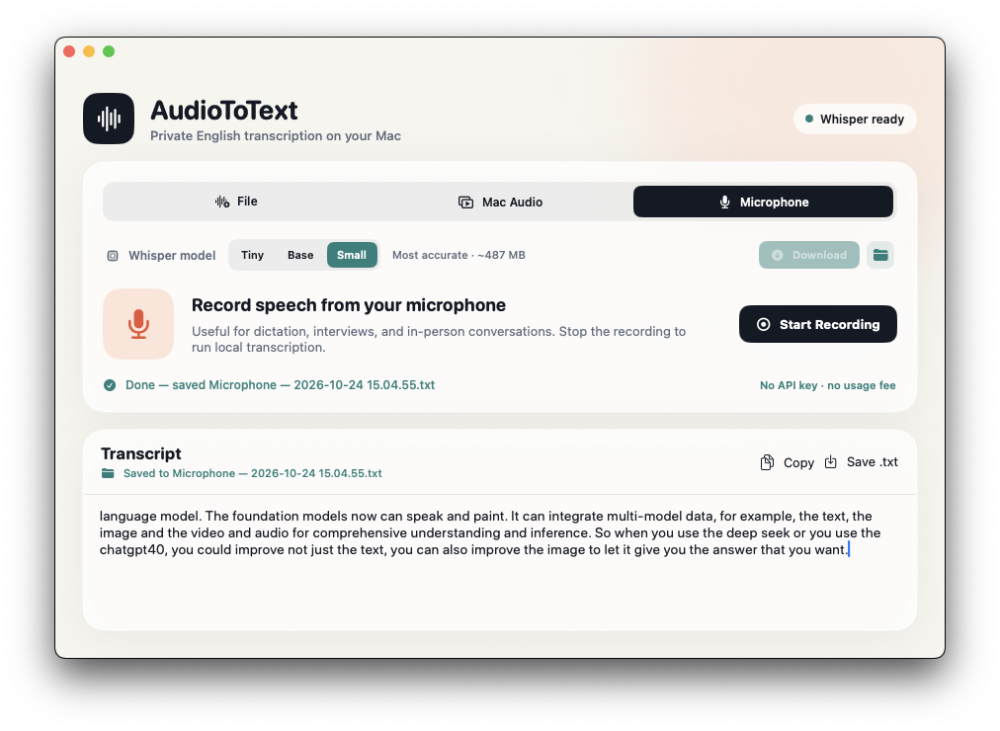

# AudioToText

AudioToText is a free, open-source macOS app that turns English speech into editable text entirely on your Mac. It can transcribe audio and video files, record a microphone, or capture sound playing in other apps.

No API key, account, subscription, or usage fee is required. Whisper models are downloaded once and then work offline.

## Screenshots

### Record and transcribe speech



### Edit and save the transcript



## Features

- Import common audio formats and videos containing an audio track.
- Open an audio or video file with AudioToText directly from Finder.
- Capture Mac audio from YouTube, movies, meetings, and other apps.
- Record speech, interviews, or dictation from a microphone.
- Choose between three English Whisper models:
  - **Tiny English** — fastest, approximately 153 MB.
  - **Base English** — balanced, approximately 147 MB.
  - **Small English** — most accurate, approximately 487 MB.
- See download percentage and progress after explicitly pressing **Download**.
- Automatically load an installed model when it is selected.
- Use the folder button to reveal an installed model in Finder.
- Edit, copy, and save transcripts as UTF-8 `.txt` files.
- Automatically save completed transcripts in `~/Documents/AudioToText`.
- Click **Done — saved…** or **Saved to…** to reveal the exact transcript file in Finder.

## Privacy and offline use

AudioToText does not upload audio or text to an app-owned server. Audio is processed locally and temporary recordings are deleted after transcription. Finished transcripts are stored locally in `~/Documents/AudioToText`.

The selected model is downloaded from the public [WhisperKit Core ML model repository](https://huggingface.co/argmaxinc/whisperkit-coreml). After the download completes, that model can be used without an internet connection.

Downloaded models are stored under:

```text
~/Documents/huggingface/models/argmaxinc/whisperkit-coreml/
```

## Requirements

- macOS 15 or newer
- Apple-silicon Mac; M1 or newer is recommended
- Xcode 16 or a compatible Swift 6 toolchain when building from source

## Build and run

```sh
git clone https://github.com/Antonkog/AudioToText.git
cd AudioToText
chmod +x Scripts/build-app.sh
./Scripts/build-app.sh
open dist/AudioToText.app
```

The first build downloads the Swift package dependencies. In the app, choose a model and press **Download**. AudioToText never starts a model download merely because the selected model changed.

For development without creating an app bundle:

```sh
swift run AudioToText
```

Run the tests with:

```sh
swift test
```

## macOS permissions

- **Microphone** permission is requested only when microphone recording is used.
- **Screen & System Audio Recording** permission is required to capture Mac audio.

If Mac Audio reports that access was declined, open **System Settings → Privacy & Security → Screen & System Audio Recording**, enable AudioToText, then quit and reopen the app.

Local ad-hoc builds receive a new code identity when the executable changes, so macOS may ask for permission again after rebuilding. To preserve identity across builds, sign with an installed Apple code-signing identity:

```sh
CODE_SIGN_IDENTITY="Apple Development: Your Name (TEAMID)" ./Scripts/build-app.sh
```

## Technology

- SwiftUI for the native macOS interface.
- [WhisperKit](https://github.com/argmaxinc/argmax-oss-swift) for local Core ML Whisper inference.
- ScreenCaptureKit for Mac system-audio capture.
- AVFoundation for microphone recording and media audio extraction.

The model engine is isolated in `WhisperEngine.swift`, allowing another backend to be added later. Python's `faster-whisper` is not the default because its standard CTranslate2 backend does not use Apple Metal; WhisperKit provides a native Core ML path with simpler packaging for this app.

## License

AudioToText is available under the [MIT License](LICENSE). WhisperKit and downloaded model assets retain their respective licenses and notices.
